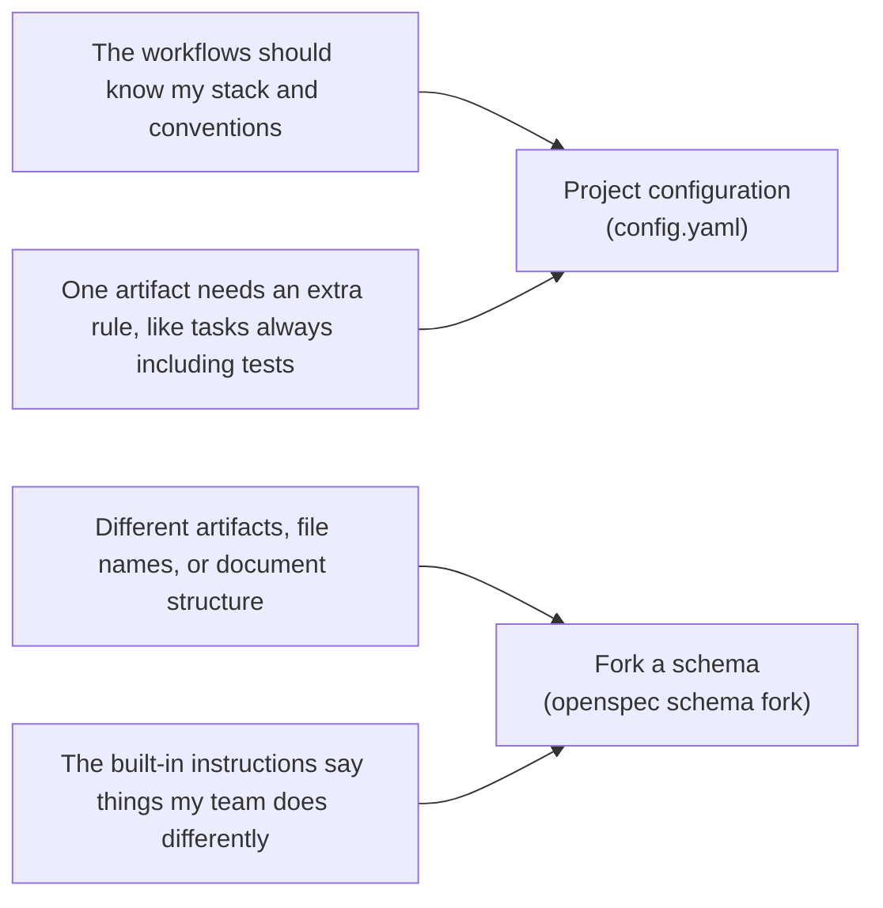

# 定制总览

OpenSpec 支持多种自定义选项。本页说明每一项改变什么，以及何时使用它。

## 可以自定义什么 [#what-you-can-customize]

| 选项 | 它改变什么 | 何时使用 |
|---|---|---|
| [配置档](./profiles.md) | 安装哪些工作流 | 你想要额外的工作流和工作方式，或想移除不需要的工作流 |
| [项目配置](./project-config.md) | 注入到每次工作流运行的指令：上下文、规则和操作指引（`config.yaml`） | 你希望变更按你的方式规划，例如任务始终包含 Playwright 测试 |
| [模式](./customize-schemas.md) | OpenSpec 产出什么：产物、它们的顺序和模板 | 变更应当产出不同的规划文件、章节或格式 |

## 不确定该用哪个？ [#not-sure-which-to-use]

配置和模式是两个层次的自定义。按你想要的动手程度来选择：

- **从[项目配置](./project-config.md)开始**：它更轻量，对大多数项目来说已经够用。你保留标准产物，并在其上添加自己的上下文和规则。
- **当添加不够时，派生（fork）一个[模式](./customize-schemas.md)**：配置只能在核心工作流之上追加。它可以添加“任务始终包含测试”这样的规则，但不能去掉设计文档或重命名文件。那属于模式的范畴。派生会给你一份自己的副本可供编辑。

*这里的“派生”指的是 `openspec schema fork` 命令，不是 fork git 仓库。[模式](./customize-schemas.md)有详细说明。*

