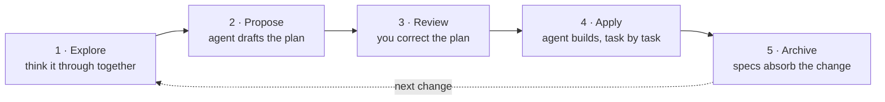

# 快速入门

开始之前，你需要在机器上装好 CLI（[安装](./installation.md)），并在项目中初始化 OpenSpec（[配置你的项目](./setup.md)）。

## 从空项目开始 [#start-from-an-empty-project]

你不必先选定技术栈或完成架构设计就能开始。在项目文件夹中初始化 OpenSpec，然后让你的智能体和你一起探索各种选项。在你的 AI 对话中：

```text
Help me explore a task tracker from scratch. I have not picked a stack. Compare the options and help me choose the first behavior to build.
```

先确定第一个变更需要什么，把后续的架构选择留空。让你的智能体为这一个变更做提案，然后按下面的步骤走。随着项目成长，你可以回头再调整架构。

## 循环一览 [#the-loop-at-a-glance]

每个变更都要经过同样的五个步骤：你和智能体把想法想透，它起草一份计划，你在写任何代码之前修正计划，智能体据此构建，最后归档把已交付的内容更新进你的规格。



下面每条提示词都写在你的 AI 对话里，也就是你请求写代码的同一个地方。示例使用平实的语言，以便在各类工具中都能用。你也可以直接调用技能；语法因工具而异（[支持的工具](./supported-tools.md)）。

## 第 1 步：探索 [#step-1-explore]

在要求写计划之前，先和智能体把想法想透。在你的 AI 对话中：

```text
Help me explore how rate limiting should work in this app.
```

探索是一种思考模式。智能体会调查你的代码库、提出关键问题、草拟选项并挑战假设。它从不写代码。除非你让它记录下你们决定的内容，或在它主动提议时你说同意，否则它什么也不写。产出是一个更清晰的想法。

问题需要多久就停多久。当形态感觉对了，就交给下一步：

```text
Propose the change we just discussed.
```

这一行会替你启动提案，并带上你们已经定下的一切。第 2 步的第一条提示词就可以跳过。

## 第 2 步：提案 [#step-2-propose]

提案把想法变成可评审的计划。从探索过来时，它已经在运行了。如果是冷启动——变更在你脑子里已经清楚——直接开口要求即可。在你的 AI 对话中：

```text
Propose a change to add rate limiting.
```

智能体会问它需要问的，然后写一个变更文件夹：

```
openspec/changes/add-rate-limiting/
├── proposal.md    why, and what changes
├── specs/         what "done" means, as testable requirements
├── design.md      technical decisions (only when the change needs one)
└── tasks.md       the implementation checklist
```

还没有代码。提案止于计划。

## 第 3 步：审阅并修正计划 [#step-3-review-and-correct-the-plan]

趁计划还只是文字、什么都还没构建时把它修好。按以下顺序阅读：

- **`proposal.md`**：这是不是对的问题，规模是否合适？
- **`specs/`**：最值得读的部分。这些需求做到这样你会接受吗？
- **`tasks.md`**：这些任务覆盖了规格吗，有没有多出来？

要修正，两种方式都行：

- 自己编辑文件。产物就是纯 Markdown，文件本身就是计划。
- 告诉智能体哪里不对（"规格漏了未认证的情形"）。它来修订产物。

## 第 4 步：实施 [#step-4-apply]

实施把计划变成代码。开一个新的对话会话，因为实现在干净的上下文窗口里效果更好。在你的 AI 对话中：

```text
Apply the add-rate-limiting change.
```

智能体读取变更文件夹，然后逐项完成 `tasks.md`，每完成一项就勾掉一项。

- **被打断了，或上下文用完了？** 开一个新会话，让它再次实施。它会从第一个未勾选的任务继续。
- **计划结果不对？** 修正产物（第 3 步的两种方式都行），然后继续实施。
- **进度**存放在 `tasks.md` 的复选框里。没有隐藏状态。

## 第 5 步：归档 [#step-5-archive]

归档做两件事：把该变更的需求更新进你的主规格，并把变更文件夹移入归档文件夹（在 `/openspec/changes/archive/*` 中）。

当 `tasks.md` 中每个框都勾选后，在你的 AI 对话中：

```text
Archive the add-rate-limiting change.
```

逐步走一遍归档会做的事：

```file-steps
## The finished change
> Implementation is done. The delta spec (what this change adds) still sits inside the change folder; specs/ doesn't know about rate limiting yet.
  openspec/
  ├── specs/                                   (no rate-limiting spec yet)
  └── changes/
      └── add-rate-limiting/
          ├── proposal.md
          ├── tasks.md                         every box checked
          └── specs/
              └── rate-limiting/
                  └── spec.md                  the delta: ADDED requirements

## Requirements land in specs/
> Each requirement in the delta lands in the main spec: added ones append, modified ones replace their old version. A new capability gets a new spec file.
  openspec/
  ├── specs/
+ │   └── rate-limiting/
+ │       └── spec.md                          gains "Requirement: Rate limiting"
  └── changes/
      └── add-rate-limiting/
          └── specs/
              └── rate-limiting/
                  └── spec.md                  the delta, source of the merge

## The folder moves to archive/
> The whole change folder, delta included, moves into the archive under a date prefix. Nothing is deleted.
  openspec/
  ├── specs/
  │   └── rate-limiting/
  │       └── spec.md
  └── changes/
-     └── add-rate-limiting/
+     └── archive/
+         └── 2026-08-08-add-rate-limiting/
+             ├── proposal.md
+             ├── tasks.md
+             └── specs/rate-limiting/spec.md

## Specs describe the system as built
> changes/ is clear for the next change. specs/ is the source of truth for what the system does; archive/ is the history of how it got there.
  openspec/
  ├── specs/
  │   └── rate-limiting/
  │       └── spec.md                          the spec as built
  └── changes/
      └── archive/
          └── 2026-08-08-add-rate-limiting/
```

Git 是另一件事。把变更文件夹和代码一起提交，工作流的其他方面都不受影响。

### 保留还是裁剪归档的变更 [#keep-or-prune-archived-changes]

`openspec/changes/archive/` 为每个已完成的变更保留提案、设计、任务和增量。在上面的归档流程中，增量已经更新了 `openspec/specs/`。

- 如果你希望当前检出中有自成一体的记录，就**保留整个变更文件夹**。
- 如果 Git 就是你的规格历史，就**删除归档变更的 `specs/` 文件夹**。先提交归档，再删除 `openspec/changes/archive/<change>/specs/`。提案、设计和任务仍留在检出中。`openspec validate --archived` 仍然可用，因为它检查的是任务完成情况，而不是已应用的增量。
- 只有当你不再需要该变更在检出中的提案、设计或任务历史时，才**删除整个变更文件夹**。当前规格不会改变，但 `openspec validate --archived` 和对检出的搜索将不再包含该变更。

> [!WARNING]
> 如果你希望 Git 保留被删除的文件，请把归档提交留在仓库历史中。把归档提交与清理提交压缩到一起会移除那个中间快照。

OpenSpec 不会自动裁剪归档的变更，也不提供保留设置。

## 继续深入 [#going-further]

- [增量规格](./schemas/spec-driven.md#delta-specs-specmd)：如何在增量规格中编写行为变化。
- [配置档](./profiles.md)：核心集合之外的可选工作流（归档前校验、增量规划）。

## 进阶指南 [#advanced-guides]

尚未撰写；以下是计划添加的指南：

- **先做原型**：在写任何规格之前先试写代码，再根据原型给你的启示回填提案。
- **迭代构建**：用一系列小变更代替一个大提案。
- **修订已实施的变更**：实施之后计划又需要变动，但该变更尚未合并或归档。
